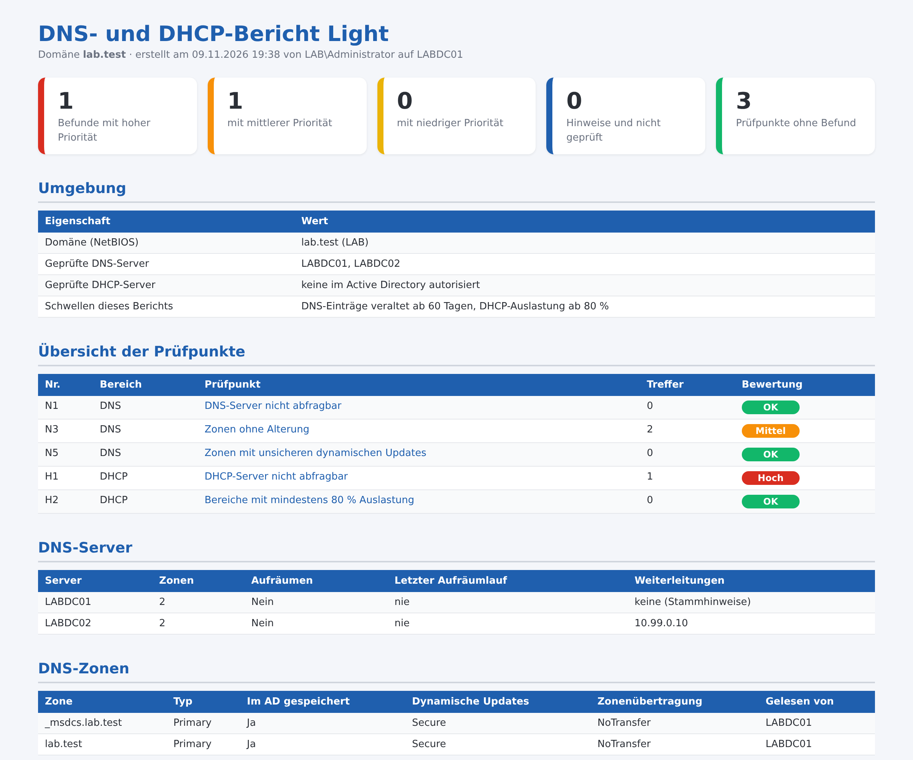

# DNS-DHCP-Bericht Light – DNS-Zonen und DHCP-Bereiche prüfen

Kostenloses PowerShell-Skript: prüft DNS-Zonen und DHCP-Bereiche der Domäne in **5 Punkten** und erzeugt einen übersichtlichen **HTML-Bericht auf Deutsch**. Es arbeitet **ausschließlich lesend**: Es ändert nichts, legt nichts an und überträgt keine Daten.



Der gezeigte Bericht stammt aus einer Testdomäne. Das vollständige Beispiel liegt als [Beispielbericht.html](Beispielbericht.html) bei.

## Was geprüft wird

| Nr. | Bereich | Prüfpunkt |
|---|---|---|
| N1 | DNS | DNS-Server nicht abfragbar |
| N3 | DNS | Zonen ohne Alterung |
| N5 | DNS | Zonen mit unsicheren dynamischen Updates |
| H1 | DHCP | DHCP-Server nicht abfragbar |
| H2 | DHCP | Bereiche mit mindestens N % Auslastung |

Jeder Befund kommt mit Erklärung und Empfehlung.

## Start

```powershell
powershell -ExecutionPolicy Bypass -File .\DNS-DHCP-Bericht-Light.ps1
```

Alle Optionen zeigt `Get-Help .\DNS-DHCP-Bericht-Light.ps1 -Detailed`. Voraussetzungen und Rechte stehen im Kopf des Skripts. Getestet mit Windows Server 2019, 2022 und 2025 in Testdomänen (deutsches Windows).

## Vollversion

Die Light-Version enthält 5 von 21 Prüfpunkten (24 %). Die **Vollversion** prüft zusätzlich unter anderem:

- Aufräumen veralteter DNS-Einträge ist nicht aktiv
- Dynamische Einträge, seit über N Tagen nicht aktualisiert
- Zonen, die nicht im Active Directory gespeichert sind
- Zonenübertragung an beliebige Server erlaubt
- Weiterleitungen antworten nicht oder sind nicht redundant
- Mehrere dynamische Namen auf derselben Adresse
- Keine Reverse-Lookupzone
- Stammzone "." vorhanden
- Deaktivierte Bereiche
- Bereiche ohne Ausfallschutz
- Failover-Beziehung nicht im Normalzustand
- Fehlende oder auffällige Optionen
- Sehr lange Lease-Dauer
- Adresskonflikte (BAD_ADDRESS)
- DHCP auf Domänencontroller ohne eigenes Konto für DNS-Einträge
- Überwachungsprotokoll ausgeschaltet

➜ **[Vollversion auf Gumroad](https://mueller86.gumroad.com/l/sthgh)** · **[Vollversion auf Etsy](https://www.etsy.com/listing/4593096270)** · **[alle Prüfskripte im Shop](https://www.etsy.com/shop/ITAdminToolsbyMM)**

## Weitere kostenlose Prüfskripte

- [AD-Schnellcheck](https://github.com/jackyno7/ad-schnellcheck) (8 Prüfpunkte zur Domäne)
- [Rechner Inventar Light](https://github.com/jackyno7/rechner-inventar-light)
- [Anmelde Sperrbericht Light](https://github.com/jackyno7/anmelde-sperrbericht-light)
- [Berechtigungsbericht Light](https://github.com/jackyno7/berechtigungsbericht-light)
- [Dateiserver Bericht Light](https://github.com/jackyno7/dateiserver-bericht-light)
- [GPO Bericht Light](https://github.com/jackyno7/gpo-bericht-light)
- [Kerberos Altlasten Check Light](https://github.com/jackyno7/kerberos-altlasten-check-light)
- [DC Gesundheitsbericht Light](https://github.com/jackyno7/dc-gesundheitsbericht-light)

## Hinweise

- Der Bericht enthält Konto-, Rechner- oder Servernamen – bitte vertraulich behandeln.
- Der Bericht zeigt Auffälligkeiten anhand fester Regeln. Er ersetzt keine Sicherheitsprüfung und erhebt keinen Anspruch auf Vollständigkeit.
- Nutzung auf eigene Verantwortung, siehe [LICENSE](LICENSE).
- Bei der Ausarbeitung wurden KI-Werkzeuge unterstützend eingesetzt; Inhalte und Skript wurden fachlich geprüft und im Testlab getestet.

---

### English

Free, read-only PowerShell script that checks DNS zones and DHCP scopes (5 checks, German HTML report with findings and recommendations). No changes are made and no data leaves the machine. Run: `powershell -ExecutionPolicy Bypass -File .\DNS-DHCP-Bericht-Light.ps1`. The full version with 21 checks: https://mueller86.gumroad.com/l/sthgh
